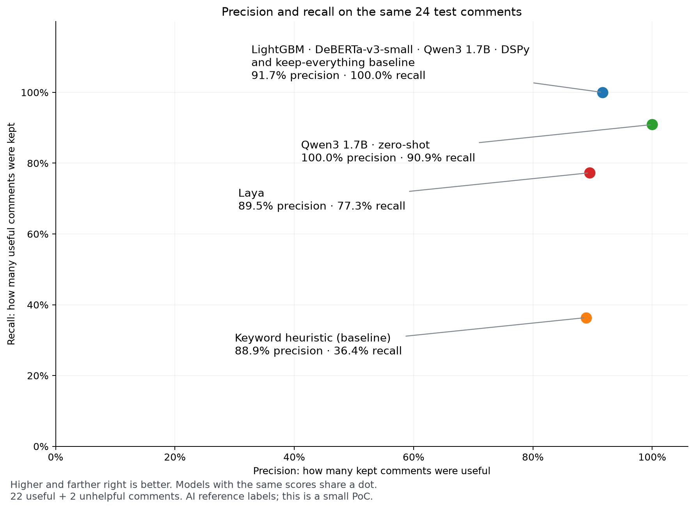
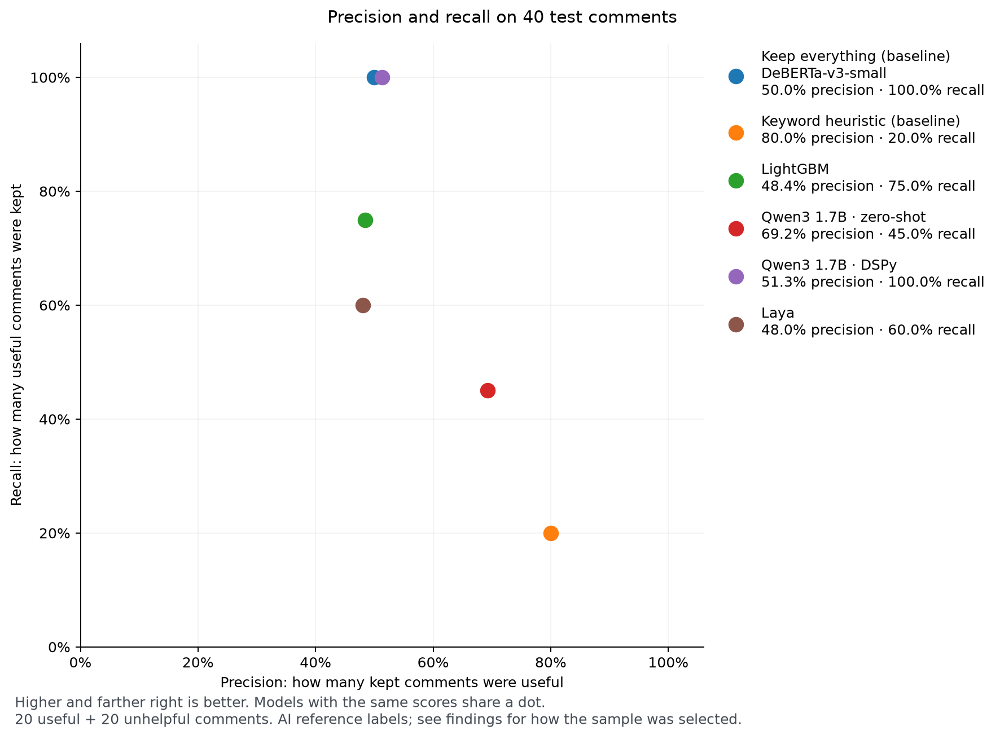

# Southampton consultation aggregation

## Abstract

We compared five approaches across different ML paradigms for filtering useful public consultation comments: classical machine learning, a fine-tuned transformer, zero-shot LLM prompting, automatic prompt tuning, and a pretrained decision model. Two small trials with AI-labelled comments gave no clear overall winner. The results showed the trade-off between removing unhelpful comments and losing useful feedback, and how much the choice of test data matters. The experiment gave us a reusable benchmark and clear next steps: add consultation context, improve the labels, and test stronger models on unseen consultations.

## Usage Instructions

Run from this directory using Nix with flakes enabled:

```sh
make data
```

## Data Sources

### s77446_carparks

- This document contains hundreds of public representations submitted during Traffic representations Order consultation to introduce parking charges across previously free.
- The council introduced the tariffs to fund car park maintenance and encourage public transport using the breeze app
- Later this course of action was reversed because of the exact issues pointed out in this document

### psg29_portswood_log

- The council got £3 million from the government to make Portswood Broadway (a busy shopping street) greener by banning regular cars from driving straight through parts of the high street
- This file contains two things
  - Specific worry or idea from a resident (e.g., "If cars are forced to turn left at St Denys Road, they might cut across cyclists going straight").
  - What the council engineers did about it (e.g., "Good point—we will paint giant bike symbols across that junction so drivers look for cyclists").
- This means every single row in this database is a True positive constructive feedback sample

### s50527_licensing

- A community venue called the Persian Cultural Centre applied for a licence to play music and serve alcohol late at night.
- In the document there are emails that neighbours wrote with complaints about the venue, alongside legal brief from council lawyers explaining which objections are legally valid
- Ground truth can be extracted from this as actionable legal complaints, however some non-valid legal complaints which would be categorised as "productive" would be marked as false in this version of the ground truth
- No false positives in ground truth, 100% accuracy maybe questionable recall against all real productive complaints

### s69290_budget

- The council proposed raising Council Tax and charging double or triple tax on houses left sitting empty.
- The document contains verbatim public comments mixed with an officer summary
- This is a addition, it can show whether a filter tuned on road/parking comments still works when the topic switches to money and taxes

### s57570_pna

- The council asked residents and health workers if there are enough local pharmacies and if their opening hours work.
- A small table of 21 responses paired with the council's reply

## Evaluation

The ML Algorithms / Models evaluated are the following. The purpose of this eval is to compare models / techniques ranging from classic ML algorithms to modern LLM's and also system-1 decision models.

There are few deliverables this research aims to achive:

1. Comparing how cost effective different implementation are in the context of filtering unproductive comments
2. Composing various inputs which can be fed into the insight generation pipeline to help narrow in on optimal prioritisation towards precision and recall
  - Current hypothesis: A false negative is generally more costly because it can result in a genuine issue never being considered
  - The question remains of determining a quantitative ratio which represents the value of recall:precision

### Classical ML - LightGBM

Basic ML model based on decision trees, the features I chose are the following: total word count, reasoning words enum, southampton place names (gazateer), rant phrases enum

### DeBERTa-v3 - advanced transformer encoder
 
Fine tune encoder using data from documents above.

### Zero-Shot LLM

Uncalibrated Zero-Shot LLM with custom prompt

### Compiled LLM - DSPy 

Rather than manual prompt compile the llm - automatically test different instructions and injects real Southampton examples into the prompt until the accuracy score peaks

### System-1 classifier - Laya

System 1 decision model - recent gain in popularity due to the release of Jev from typesafe-AI 

## Results

**Verdict:** LLMs are promising when labels are limited, but no reliable filter emerged. Zero-shot Qwen had the highest expanded-test accuracy (62.5%), while losing 11 of 20 useful comments. DSPy kept useful comments but barely filtered.

**Rubric:** Useful comments give a clear issue, reason, impact, experience or suggestion about the consultation. Anger and bad spelling are fine. Bare opinions, abuse or off-topic text with no useful point do not count.

First test: 22 useful, two unhelpful comments. Expanded test: 20 of each. **Lost** means useful comments wrongly removed; **filtered** means unhelpful comments correctly removed.

| Model | First test | Expanded test |
| --- | --- | --- |
| LightGBM | Lost 0; filtered 0. | Lost 5; filtered 4. |
| DeBERTa-v3-small | Lost 0; filtered 0. | Lost 0; filtered 0: kept everything again. |
| Qwen3 1.7B, zero-shot | Lost 2; filtered 2. | Lost 11; filtered 16: more filtering, many useful comments lost. |
| Qwen3 1.7B, DSPy | Lost 0; filtered 0. | Lost 0; filtered 1: kept useful feedback, barely filtered. |
| Laya | Lost 5; filtered 0. | Lost 8; filtered 7. |

Keeping everything scored 91.7% accuracy in the first test and 50% in the second.

- Precision measures usefulness among kept comments.
- Recall measures how many useful comments we kept.
- Accuracy measures all correct decisions.

**First trial - 24 comments (22 useful, two unhelpful):**



[First-trial stats](benchmark/previous/results/results.csv). Four models share the same point because they kept every comment.

**Expanded trial - 40 comments (20 useful, 20 unhelpful):**



We expanded from 120 to **310 comments, including 73 unhelpful ones**. The new test uses fresh parking comments matched by rough length. Both tests are small selected samples, and their different class mixes make precision and accuracy unsuitable for a direct before/after comparison.

**What this supports:** Our LightGBM used only four counts. DeBERTa had brief training and limited labels. These results do not establish that classical ML cannot handle varied text, or that missing structured data caused the failures. [Small trained text models can also compete with larger LLMs.](https://aclanthology.org/2025.emnlp-main.9/) Qwen was promising and makes stronger LLMs worth testing, but their success remains a hypothesis.

**Next trials:**

1. Add the actual consultation question and a short proposal summary, so short comments have context.
2. Add balanced training examples: short useful answers, angry useful comments, and bare opposition. Ask the LLM to quote the useful point.
3. Allow **keep / unsure / discard**. Keep unsure comments; choose decisions on validation data to avoid losing useful feedback. Measure confidence rather than trusting a self-reported percentage.
4. Compare a larger local LLM and a frontier LLM with the same inputs, recording missed useful comments, filtering, speed and cost.
5. Test [TF-IDF word features with a linear classifier](https://scikit-learn.org/stable/auto_examples/text/plot_document_classification_20newsgroups.html), [sentence embeddings](https://arxiv.org/abs/2209.11055), and balanced encoder training. Later, try fine-tuning a small LLM on checked labels.

[Results](benchmark/results/results.csv) · [Predictions](benchmark/results/case_predictions.csv) · [Details](benchmark/results/findings.md) · [First experiment](benchmark/previous/results/findings.md). Rebuild the figures with `make analysis`.
