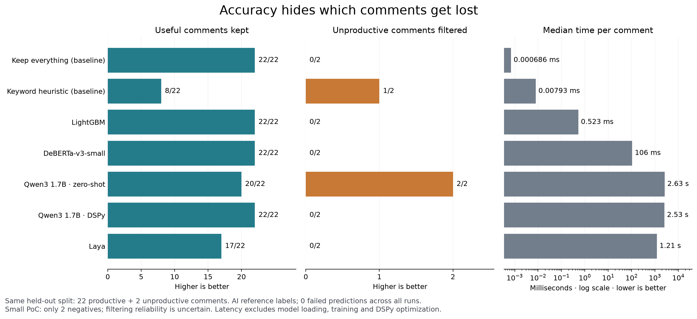

**Accuracy hides which comments get lost.**

All five models and two baselines completed the same 24-comment held-out split, with zero failed predictions. The split contains 22 productive and two unproductive comments, using the saved AI reference labels.

| Model | Useful kept / 22 | Unproductive filtered / 2 | Accuracy | Median prediction | Setup / training |
| --- | ---: | ---: | ---: | ---: | ---: |
| Keep everything (baseline) | 22 | 0 | 91.7% | 0.000686 ms | 0.00 s |
| Keyword heuristic (baseline) | 8 | 1 | 37.5% | 0.00793 ms | 0.00 s |
| LightGBM | 22 | 0 | 91.7% | 0.523 ms | 0.01 s |
| DeBERTa-v3-small | 22 | 0 | 91.7% | 106 ms | 64.97 s |
| Qwen3 1.7B zero-shot | 20 | 2 | 91.7% | 2.63 s | 0.00 s |
| Qwen3 1.7B DSPy | 22 | 0 | 91.7% | 2.53 s | 409.43 s |
| Laya | 17 | 0 | 70.8% | 1.21 s | 0.42 s |

Keeping everything and zero-shot Qwen both achieve 91.7% accuracy. Keeping everything loses no useful feedback but filters nothing. Qwen filters both unproductive comments but loses two useful ones. The practical choice depends on the relative cost of missing useful feedback and reading unhelpful feedback. If missing a useful comment costs five times as much, these errors cost 10 units for Qwen versus two for keeping everything; this is a scenario, not a measured monetary cost.

LightGBM, DeBERTa and DSPy make exactly the baseline decisions on this test split. Laya loses five useful comments and filters neither negative. The heuristic loses 14 useful comments while filtering one negative. None improves on the baseline in overall accuracy in these configured runs.

DSPy took about 409 seconds to compile, with 105 model-call history entries recorded. Its best validation accuracy tied its starting prompt at 87.5%, and the saved program retained the original rubric without demonstrations. That is no observed validation gain from this optimization budget; the DSPy wrapper and direct zero-shot prompt are different input formats, so their test difference cannot be attributed solely to optimization.

The two zero-shot false negatives concern insufficient time to discuss the proposal and harm to local shopping. The latter includes anger but also a specific claimed economic impact, which the reference rubric treats as productive. Inspect these cases in case_predictions.csv rather than relying only on aggregate scores.

This is a small PoC using AI labels and one stratified split, not evidence that one architecture is generally better. Two negative test examples cannot establish filtering reliability. More varied unproductive examples would make the next comparison more informative. Timings are observed local adapter prediction times, excluding dataframe validation, loading, training and prompt optimization; they are not isolated hardware measurements.

Artifacts: [SVG](story.svg), [results CSV](results.csv), [all per-comment predictions](case_predictions.csv), [comparison report](report.html). Regenerate the figure and case table with `make analysis`.
